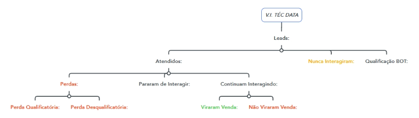
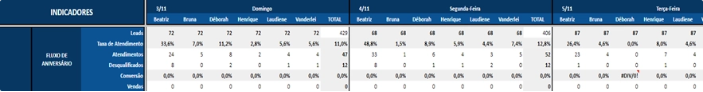
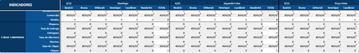
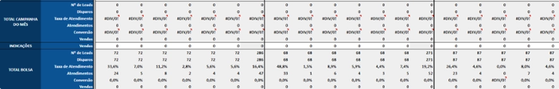
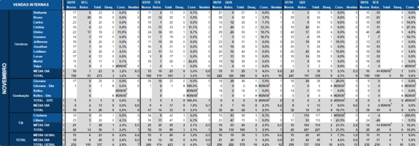
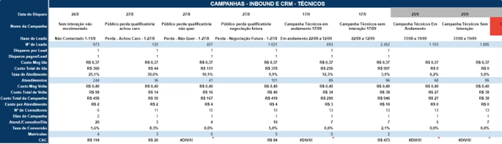
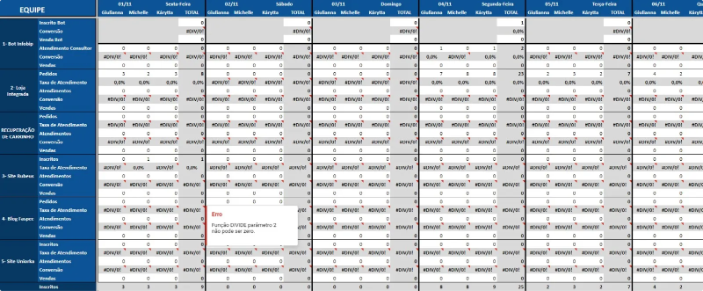

# 📇 FASPEC — Gestão de CRM

Dashboard em **Power BI** para gestão e análise de desempenho das campanhas de captação e comunicação de leads, focado em **educação a distância** e venda de **cursos técnicos**.

📄 Metodologia completa: [Gestão de CRM (Notion)](https://www.notion.so/Gest-o-de-CRM-1462d5f40ff780dbb232da835aaeb7fb)

> ℹ️ O dashboard foi descontinuado, mas este repositório guarda o histórico, o contexto e os objetivos da sua criação.

## 🎯 Objetivo

Dar uma visão completa do processo de **captação, atendimento e engajamento de leads**, com o objetivo final de aumentar a conversão de leads em matriculados ou clientes. Com essas informações é possível melhorar continuamente as estratégias para:

- **Eficiência de captação e atendimento:** aumentar o atendimento e a conversão
- **Funil de vendas:** reduzir perdas e aumentar ganhos
- **Engajamento por e-mail:** aumentar as taxas de abertura e cliques, maximizando a efetividade da comunicação

## 🛠️ Como foi construído

- Dashboard com **7 telas**, contando a capa.
- Dados vindos das **APIs da Rubeus** (CRM), conectadas diretamente ao Power BI via Web.
- **ETL** no Power Query e **medidas DAX** para os cálculos e indicadores.

## 🔻 Funil de leads

Telas de mapa mental para **EJA, Graduação e Técnico** acompanham dinamicamente a quantidade de leads em cada etapa do funil e as taxas de atendimento de cada canal, filtradas pela data desejada. No dashboard, cada etapa (Atendidos, Perdas, Viraram Venda etc.) exibe a quantidade correspondente.

## 📉 O problema: tudo no Excel

Antes, os atendimentos eram separados em várias abas do Excel. Os principais problemas eram o **excesso de informações** e o **layout muito denso**, com dados aglomerados e sem destaque para os indicadores importantes.

**Bolsa Interna** — uma planilha enorme:

**Métricas de e-mail:**

**Totais**, vistos apenas no final da planilha:

Além disso, os dados eram de **um único mês** (novembro). Para consultar outros meses, era preciso abrir outra planilha.

**Vendas Internas** também tinham uma aba própria, com excesso de colunas e linhas e muitos detalhes em uma única visualização:

**Disparos para grupos com muitos leads acumulados** eram feitos à mão: conferindo os valores no CRM e passando para o Excel, num trabalho minucioso e demorado.

## ✅ A solução no Power BI

- Telas dedicadas para **Bolsa Interna** e para **e-mails**, cada uma com o total consolidado.
- **Filtro de data** livre, sem precisar trocar de planilha.
- **Filtro por processo** (Ensino Médio, Graduação e Pós, Técnico): médias e totais se ajustam dinamicamente, e os processos podem ser combinados em uma única visão.

## 📊 Principais indicadores

| Indicador | Descrição |
|---|---|
| **Leads** | Total de leads gerados: **61.474** |
| **Média de leads e de atendimento** | Média por consultor, mostrando como cada um atende os leads no período. Média de leads por responsável: **6.147** |
| **Atendimentos** | Total de atendimentos realizados: **11.362** |
| **Taxa de atendimento geral** | Percentual de leads atendidos sobre o total: **18,48%** |
| **Ganhos** | Total de leads convertidos em ganhos |
| **Desqualificados** | Leads desqualificados, com base nas perdas do período e nas perdas da Infobip |

## 🧰 Ferramentas

Power BI · Power Query · DAX · API Rubeus (CRM) · Infobip · Excel
